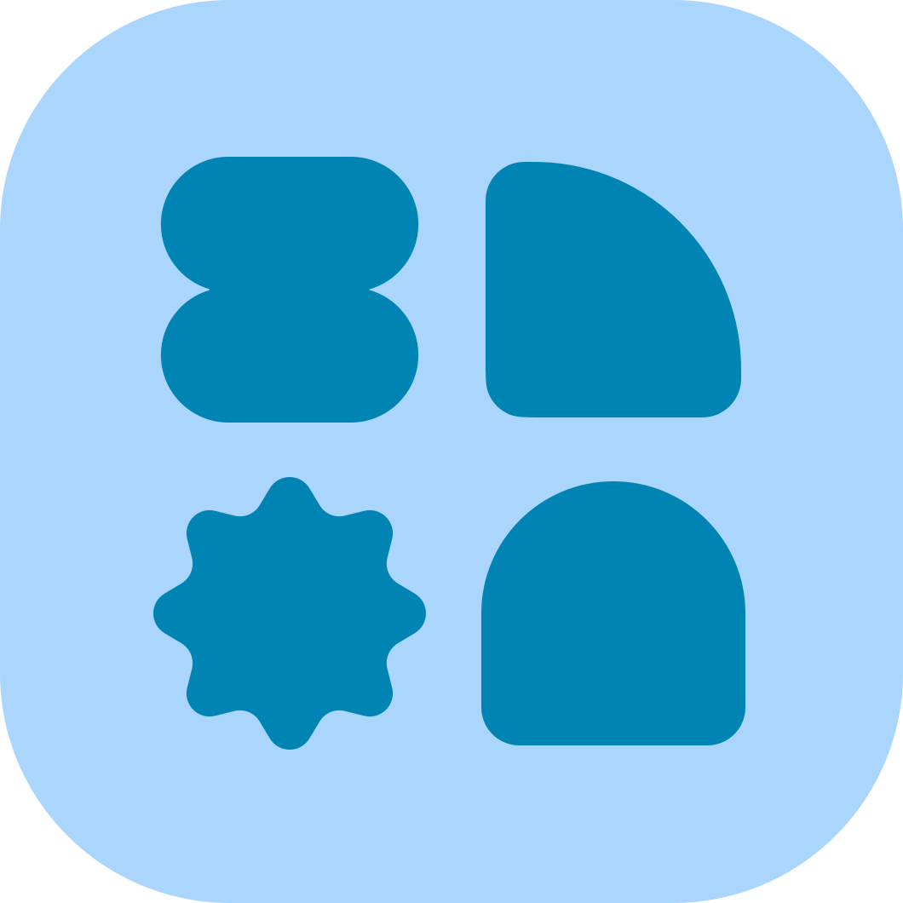

<p align="center">
  
</p>

<h1 align="center">Material 3 Expressive Skill</h1>

<p align="center">
  A production-minded Agent Skill for designing, implementing, and reviewing<br>
  interfaces with <strong>Material 3 Expressive</strong>.
</p>

<p align="center">
  <a href="https://github.com/asimawdah/material-expressive-skill/actions/workflows/validate.yml"></a>
  <a href="https://agentskills.io/"></a>
  <a href="LICENSE"></a>
</p>

<p align="center">
  <a href="https://youtu.be/M8OkHgELmmI">
    
  </a>
</p>

<p align="center">
  <sub>Click the cover to watch the video on YouTube.</sub>
</p>

<p align="center">
  <a href="#install">Install</a> ·
  <a href="#what-it-helps-with">Capabilities</a> ·
  <a href="SKILL.md">Read the skill</a> ·
  <a href="#documentation">Documentation</a>
</p>

> **Express with intent.** This skill helps an AI agent make deliberate product, interaction, accessibility, and engineering decisions — using expressive design where it improves hierarchy, recognition, feedback, or emotional clarity, not just to make screens louder or rounder.

## What it helps with

- Design new screens and end-to-end app flows using Material 3 semantics.
- Apply M3 Expressive intentionally: size, color, shape, motion, typography, containment, and flexible component composition.
- Build and refine semantic themes for light, dark, and dynamic color.
- Select appropriate Material components and states for the target platform.
- Plan adaptive experiences for phones, tablets, foldables, desktop windows, and wearable surfaces.
- Implement, modernize, and review interfaces without inventing unsupported APIs.
- Deliver accessible, internationalized, production-ready UI and developer handoff notes.

## Design principles

1. **Start with the user task.** Information architecture, content hierarchy, and interaction come before decoration.
2. **Preserve Material semantics.** A button must remain recognizable as a button; selected, disabled, destructive, and navigational states must remain clear.
3. **Express with intent.** Choose only the expressive treatments that make the important information or action easier to understand.
4. **Respect platform capability.** Native expressive components and APIs vary by platform and library. Use supported components where available; adapt principles honestly elsewhere.
5. **Ship complete states.** Loading, empty, error, success, disabled, focus, hover, and pressed states are part of the design.
6. **Treat accessibility as a release requirement.** Include keyboard, screen-reader, contrast, text scaling, reduced motion, and localization checks.

## Install

The recommended route is the Skills CLI:

```bash
npx skills add asimawdah/material-expressive-skill
```

Choose the agent and installation scope supported by the CLI. The repository follows the open Agent Skills directory format and has no runtime dependencies.

### Manual installation

Clone or copy the repository into the skill directory used by your agent. For example:

```bash
# OpenAI Codex
git clone https://github.com/asimawdah/material-expressive-skill.git \
  ~/.codex/skills/material-expressive-skill

# Claude Code
git clone https://github.com/asimawdah/material-expressive-skill.git \
  ~/.claude/skills/material-expressive-skill
```

For other clients, use their current documented Agent Skills directory. Restart or refresh the client if it does not discover the new skill automatically.

## Use

After installation, ask naturally:

- "Design an expressive Material 3 dashboard for a personal finance app."
- "Implement this screen in Jetpack Compose using Material 3 Expressive."
- "Review this Flutter screen for Material 3 consistency and accessibility."
- "Adapt this mobile flow for tablet and desktop windows."
- "Audit this interface and suggest only the expressive changes that improve its hierarchy."

The skill is triggered by requests involving Material Design 3, M3 Expressive, Material You, expressive Material interfaces, relevant implementation work, or Material-focused design reviews.

## Package structure

```text
material-expressive-skill/
├── SKILL.md
├── README.md
├── CHANGELOG.md
├── CONTRIBUTING.md
├── LICENSE
├── assets/
│   ├── expressive_icon.svg
│   └── Introducing-Material-3-Expressive.jpg
├── references/
│   ├── expressive-principles.md
│   ├── design-foundations.md
│   ├── components-and-patterns.md
│   ├── motion-and-feedback.md
│   ├── adaptive-layouts.md
│   ├── accessibility-and-internationalization.md
│   ├── platform-guidance.md
│   ├── implementation-workflow.md
│   ├── review-checklist.md
│   └── official-sources.md
├── examples/
│   └── expressive-task-list.md
├── templates/
│   ├── design-brief.md
│   └── implementation-handoff.md
├── scripts/
│   └── validate_skill.py
├── tests/
│   └── test_validate_skill.py
└── .github/
    └── workflows/
        └── validate.yml
```

The root `SKILL.md` is the decision engine. Focused references are loaded only when a task needs them, keeping the default context small and easier to maintain.

## Platform support model

| Target | Guidance |
| --- | --- |
| Android / Jetpack Compose | Primary native implementation path; verify current Compose Material 3 APIs and release channel. |
| Wear OS | Use Wear Compose Material 3 and wearable-specific patterns. |
| Android Views | Use available Material Components and platform conventions; do not assume Compose-only APIs exist. |
| Flutter | Apply Material 3 roles and patterns with the Flutter SDK's actual widget and theme support. |
| Web | Apply semantic tokens, responsive structure, and accessible interaction; do not claim native Compose expressive parity. |
| React Native / SwiftUI / other | Adapt the design principles to the target platform's native conventions and available component ecosystem. |

This is a design and implementation skill, not a replacement component library. It does not bundle third-party UI packages or claim that every M3 Expressive component is available everywhere.

## Documentation

Start with [SKILL.md](SKILL.md), then open the references relevant to the task:

- [Expressive principles](references/expressive-principles.md)
- [Design foundations and tokens](references/design-foundations.md)
- [Components and patterns](references/components-and-patterns.md)
- [Motion and feedback](references/motion-and-feedback.md)
- [Adaptive layouts](references/adaptive-layouts.md)
- [Accessibility and internationalization](references/accessibility-and-internationalization.md)
- [Platform guidance](references/platform-guidance.md)
- [Implementation workflow](references/implementation-workflow.md)
- [Review checklist](references/review-checklist.md)
- [Official sources and version verification](references/official-sources.md)

See the [expressive task-list walkthrough](examples/expressive-task-list.md) for a practical design decision example. Reusable planning documents are available in [templates/](templates/).

## Validate locally

Requires Python 3.10 or newer. No third-party packages are needed.

```bash
python scripts/validate_skill.py
python -m unittest discover -s tests -v
```

GitHub Actions runs the same checks for pushes and pull requests.

## Source and update policy

Official Material guidance and platform API documentation are the source of truth. Before using a new component, token, dependency, or API, verify its current availability for the target platform and release channel. Record meaningful changes in [CHANGELOG.md](CHANGELOG.md).

The references summarize guidance in original wording and link to authoritative sources. Material Design and related names are trademarks of Google; this project is independent and is not affiliated with or endorsed by Google.

## Contributing

Corrections, platform notes, examples, and improvements are welcome. Read [CONTRIBUTING.md](CONTRIBUTING.md) before opening a pull request.

## License

MIT. See [LICENSE](LICENSE).
